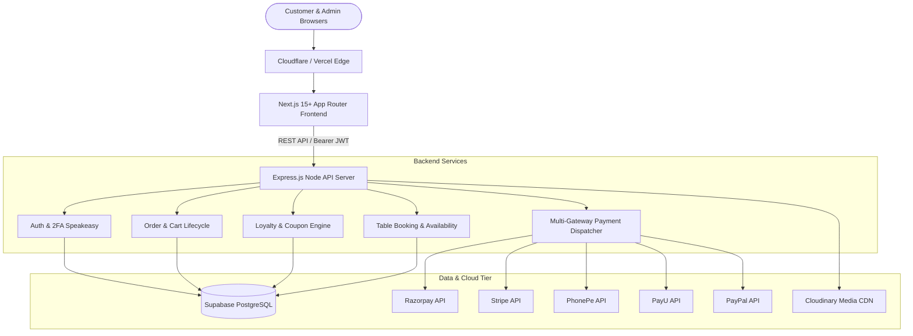
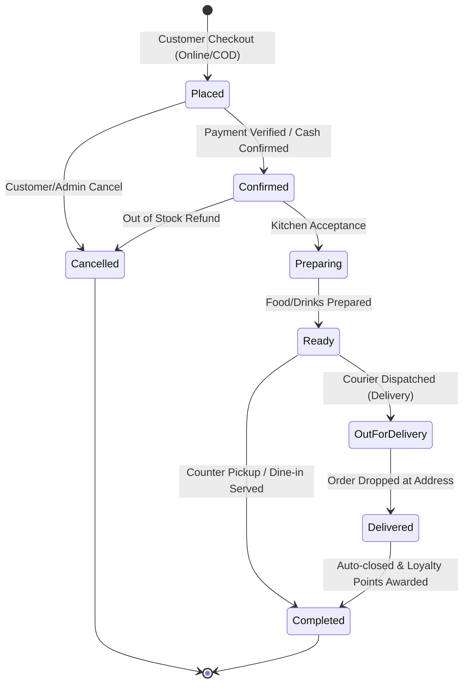

# Cafex Architecture & UI/UX Design System

## 1. System Overview

Cafex is an enterprise-grade Cafe Management & Online Ordering Platform engineered with a decoupled, high-performance architecture:
- **Frontend**: Next.js 15+ App Router, React 19, TypeScript, Tailwind CSS, Lucide Icons, Framer Motion, and PWA capabilities.
- **Backend**: Node.js & Express REST API with strict RBAC, JWT authentication with refresh rotation, TOTP 2FA for Administrators, and multi-gateway payment processing.
- **Database**: Supabase PostgreSQL with relational integrity, triggers, row-level security (RLS), and a drop-in MongoDB Atlas alternative.
- **Storage**: Cloudinary CDN for optimized webp/avif image transformations.
- **Deployment**: Vercel (Edge Frontend) + Render / Railway / Docker (Containerized Backend) + Supabase (Managed DB).

---

## 2. Security & Authentication Architecture

1. **Role-Based Access Control (RBAC)**:
   - `customer`: Browse menu, place orders, book reservations, track real-time orders, manage loyalty points & reviews.
   - `staff / kitchen`: View kitchen display system (KDS), update order status (preparing, ready, dispatched).
   - `manager`: Manage table assignments, reservations, inventory stock status.
   - `admin / super_admin`: Full dashboard access, financial analytics, menu CRUD, customer moderation, coupons, system settings.
2. **Admin Two-Factor Authentication (2FA)**:
   - Time-based One-Time Password (TOTP) compatible with Google Authenticator, Authy, and 1Password.
   - Admin login requires master password + 6-digit TOTP verification code.
3. **Defense in Depth**:
   - `Helmet` HTTP security headers (HSTS, Content Security Policy, X-Frame-Options).
   - `express-rate-limit` against brute-force attacks on `/api/auth/*` and `/api/checkout/*`.
   - `bcrypt` salted password hashing with 10 rounds.
   - Input validation and sanitization using strict schema validators.
   - Standard CORS policy restricting trusted frontend domains.

---

## 3. Order Lifecycle State Machine

---

## 4. UI/UX Design System & Theme Tokens

### Color Palette
- **Primary / Brand Accent**: Amber & Warm Bronze (`#D97706` / `hsl(38 92% 50%)`) — evokes artisanal espresso crema, roasted beans, and welcoming warmth.
- **Secondary**: Deep Espresso Roast (`#1C1917` / `#292524`) — rich slate-stone grounding.
- **Warm Cream / Light Mode Base**: `#FAF8F5` / `#F5F2EB` — warm paper and latte froth tone, eliminating harsh pure white glare.
- **Dark Mode Surface**: Deep Charcoal Obsidian (`#0F0D0C` / `#171513`).
- **Success / Botanical Green**: `#059669` — used for vegan/organic badges and confirmed order status.
- **Muted Accent**: `#78716C` — subtle secondary typography and metadata.

### Typography
- **Headings**: Modern Serif / Display Elegance (`Playfair Display`, `Cinzel`, or high-contrast Sans `Plus Jakarta Sans`).
- **Body & Controls**: Clean legible geometric sans (`Inter`, `Plus Jakarta Sans`).

### Interactive Design Highlights
- **Micro-Interactions**: Smooth slide-over shopping cart drawer with instant badge counters.
- **Sensory Menu Customizer**: Modal bottom-sheet allowing custom milk choices, syrups, extra shots with real-time price updates.
- **Live Order Timeline**: Pulsing animated step markers showing the exact stage of food preparation and delivery.
- **Accessibility**: Full keyboard navigable focus rings, WCAG AAA contrast ratio compliance, and explicit aria labels.
